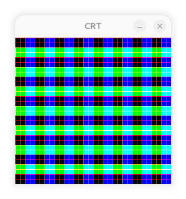

# Some examples of a verilog book

This book is advertised by Fabien Marteau on his blog.
Designing video game hardware in verilog from Steven Hugg.
To practice a little bit, understand the code I reproduced some of the example with verilator (verilog simulator) and SDL (graphic output).

- Example 'A test pattern'
- Example 'Sprites'

My machine HP Pavilion laptop 15-eh1xxx. OS Ubuntu 2026.06 native. Did not work with virtualbox.

The author propose a simulator. This allows to see the full code of the examples. Site 8bitworkskop.com.

